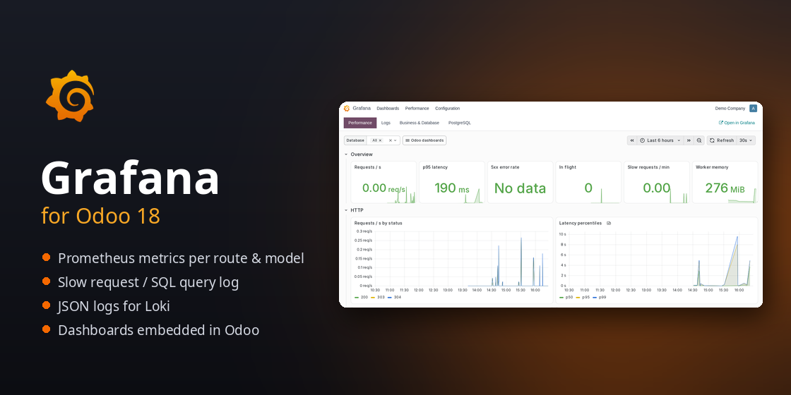
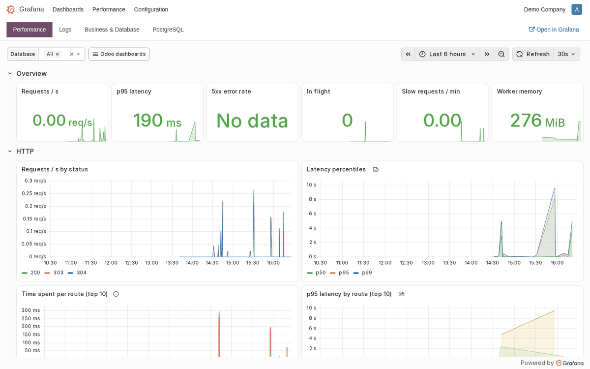
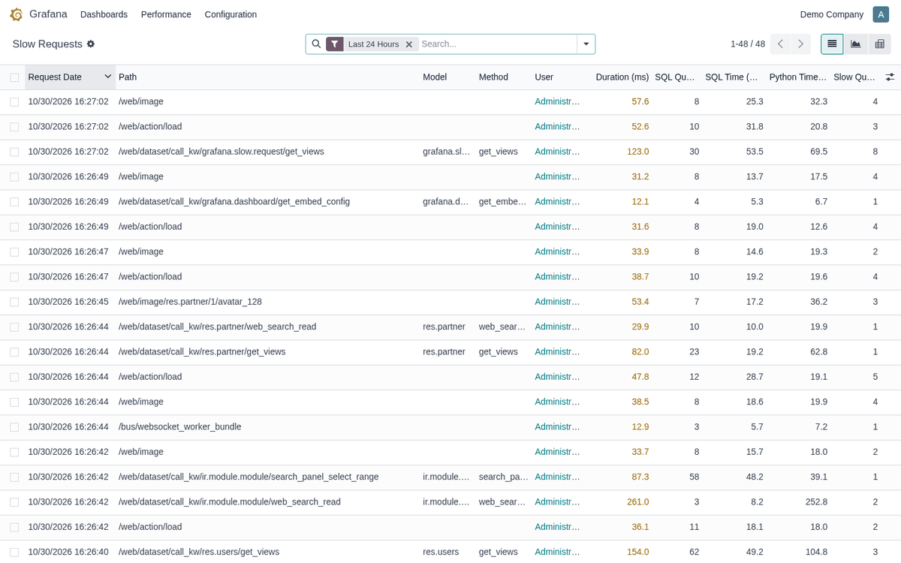
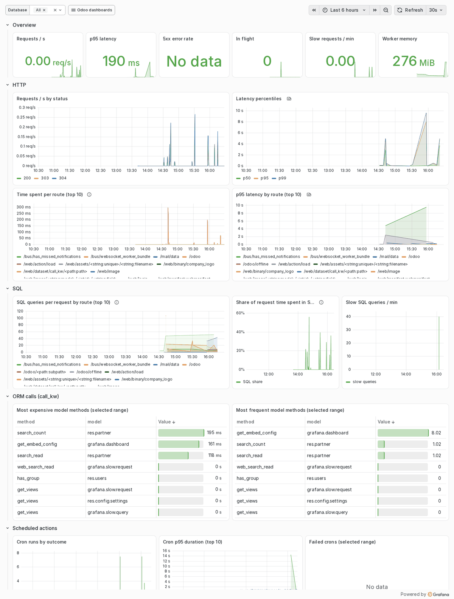
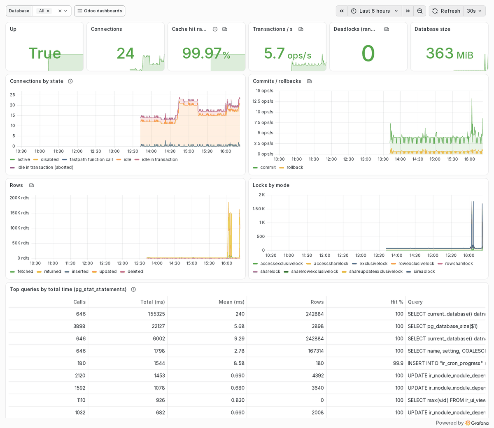

# Grafana for Odoo



Odoo 18 module that plugs Odoo into the Grafana stack (Prometheus, Loki,
Grafana) to monitor performance, track logs and visualise data.

* **`/metrics` Prometheus endpoint**, aggregated across prefork workers: HTTP
  latency per route, SQL queries and SQL time per request, ORM calls per
  model/method, cron runs and duration, worker memory, warning/error rate.
* **Slow request and slow SQL query log**, browsable in Odoo (list, graph,
  pivot) and queried by Grafana from PostgreSQL.
* **JSON logs**, one object per line with database, user, query count and
  timing, ready for Loki.
* **Grafana dashboards embedded in the Odoo backend**: Performance, Logs,
  Business & Database, PostgreSQL.
* **Ready-to-run Docker stack** in [`grafana/deploy`](grafana/deploy):
  Prometheus, Loki, Grafana Alloy, Grafana and postgres-exporter, with data
  sources and dashboards provisioned.

| Embedded in Odoo | Slow request log |
|---|---|
|  |  |
| **Performance dashboard** | **PostgreSQL dashboard** |
|  |  |

## Repository layout

| Path | |
|---|---|
| [`grafana/`](grafana) | the Odoo module (technical name `grafana`) |
| [`grafana/deploy/`](grafana/deploy) | Docker Compose monitoring stack, dashboards, nginx snippet |

Branches follow Odoo versions: `18.0`.

## Quick start

1. Add this repository to the Odoo addons path and install the Python
   dependency:

   ```
   pip install -r requirements.txt
   ```

2. Load the module server-wide in the Odoo configuration file:

   ```
   server_wide_modules = base,web,grafana
   grafana_log_json = True
   ```

   With `workers > 0`, also set `PROMETHEUS_MULTIPROC_DIR` to an empty
   directory (wiped at each start, a tmpfs is ideal), so metrics are
   aggregated across workers.

3. Restart Odoo and install the **Grafana** app.

4. Start the monitoring stack: see [`grafana/deploy/README.md`](grafana/deploy/README.md).

Configuration lives in **Settings → Grafana** (Grafana URL, slow request and
slow query thresholds, log retention). Access is granted through the
**Grafana / Viewer** and **Grafana / Administrator** groups.

## Configuration options

| Odoo config file | Environment | |
|---|---|---|
| `grafana_log_json = True` | `ODOO_LOG_JSON=1` | JSON log lines |
| `grafana_metrics_token` | `ODOO_METRICS_TOKEN` | bearer token required on `/metrics` |
| `grafana_slow_request_ms` | | default slow request threshold (ms) |
| `grafana_slow_query_ms` | | default slow query threshold (ms) |
| | `PROMETHEUS_MULTIPROC_DIR` | shared metrics directory for prefork workers |

## Tests

```
odoo-bin -d <test db> -i grafana --test-tags /grafana --stop-after-init
```

## License

[LGPL-3](LICENSE). Grafana is a trademark of Grafana Labs; this module is an
independent integration and is not affiliated with or endorsed by Grafana
Labs.
